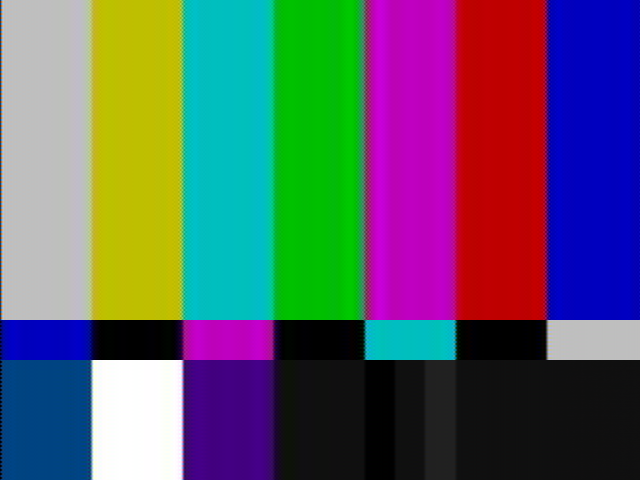
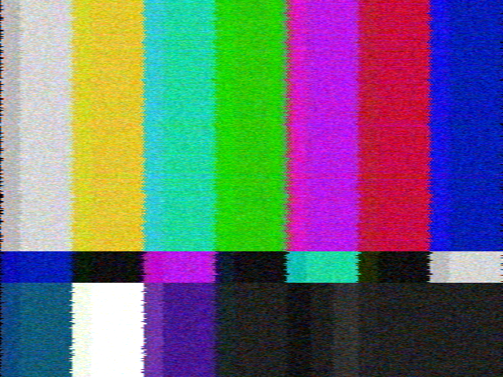

# NTSC Composite Simulator

Simulate the NTSC composite video signal encoding and decoding pipeline. Process video or images through an accurate analog signal path to reproduce the characteristic artifacts of NTSC television — color bleeding, rainbow cross-color, dot crawl, and chroma/luma bandwidth limitations.

## Examples

| Source | NTSC Roundtrip | Degraded Signal |
|:---:|:---:|:---:|
|  |  |  |
| Clean SMPTE color bars | After encode/decode roundtrip | With noise, ghosting, attenuation, and jitter |

## Features

- **GUI** (`ntsc-gui`) with live before/after preview, presets, and batch processing
- **Roundtrip** video through the full encode/decode pipeline in memory
- **Telecine** simulation with 3:2 pulldown (24p film → 480i interlaced)
- **Image** processing through the NTSC signal path
- **SMPTE color bars** test pattern generator
- **Physically-motivated signal degradation**: noise (snow), multipath ghosting, attenuation, horizontal jitter
- **Realistic multipath ghosting model**: multiple reflections, phase shift (polarity inversion), HF rolloff, sub-sample delay interpolation, dynamic amplitude modulation
- **VHS tape-path simulation**: luma bandwidth limiting, color-under chroma processing, tape dropouts, edge ringing, luminance-dependent noise, head-wear smearing, causal rightward trailing, head-switching noise, top-of-frame chroma bands, and closed-caption data lines
- **Presets**: `--vhs-preset lq|mq|hq` sets the full VHS look at once; `legacy-lq|mq|hq` reproduce the original tape-path settings; custom presets load from JSON with `--preset-file`
- **Range parameters**: all numeric effect arguments accept `min..max` ranges — a random value is sampled per file in batch mode for natural variation
- **Two comb filter modes**: horizontal 2-sample delay (default) and 1H line-delay
- Parallel frame processing via rayon

## Building

Requires Rust 1.95+ (for the GUI; the CLI alone builds with older versions) and [ffmpeg](https://ffmpeg.org/) on your PATH (for video I/O). ffmpeg/ffprobe are only ever run as separate programs; they are not linked into or shipped with this project.

From the repository root:

```bash
cargo build --release
```

This builds two binaries in `target/release/` (`.exe` on Windows):

- `ntsc-composite-simulator` — the command-line tool
- `ntsc-gui` — the GUI with live preview (see [GUI](#gui))

To build only the command-line tool, without the GUI dependencies:

```bash
cargo build --release --no-default-features
```

The crate is a library (`src/lib.rs`: encoder, decoder, effects, the shared parameter model in `params.rs`, presets, and the processing pipeline in `pipeline.rs`) with two thin front ends: the CLI in `src/main.rs` and the GUI in `src/bin/ntsc-gui/` (behind the default `gui` feature). Every effect parameter (flag name, label, help text, unit, slider range, default, group) is defined once in `src/params.rs`; the CLI flags and the GUI controls are both generated from that table.

## GUI

```bash
cargo run --release --bin ntsc-gui
# or open a file straight away
target/release/ntsc-gui photo.png
```

- **Settings panel** (left): pick a preset (VHS `lq`/`mq`/`hq`, VHS legacy, or your own), then fine-tune in collapsible groups that follow the signal chain: Tape, Colour, Noise & dropouts, Timing, Reception, Decoder / output. Every parameter has an on/off box, a slider with its unit, a tooltip explaining what it looks like, and a **range** toggle that turns the slider into min/max. Editing marks the preset as *modified*; **Reset group** and **Reset all** go back to the preset. **Save…** / **Load…** store presets as JSON, the same format as `--preset-file`.
- **Preview** (centre): opens with SMPTE colour bars. **Open…** or drag and drop an image, a video (one frame is previewed; scrub with the time slider), or a preset `.json`. Views: **Split** (drag the divider), **Side by side**, **After**. Zoom: **Fit**, **1×**, **2×**, **4×** (nearest neighbour; drag to pan, double-click to centre).
- **Live rendering** runs in the background, 150 ms after the last change, always on the newest settings. The status bar shows the render time and the **sampled values** that the ranges resolved to. **Seed** + **Reroll** change the random draws; **Frame** steps through frames to see per-frame effects and, with temporal coherence on, the slow drift of the tape state.
- **Toolbar**: **Copy CLI command** copies the exact equivalent `ntsc-composite-simulator` command line, **Save PNG…** saves the processed preview, and **Process…** runs the current settings over a file or a whole folder (images, or video roundtrip: lossless by default, optional lossy CRF, encoder preset, telecine) with a progress bar and **Cancel**. Processing uses the same library code as the CLI, so the output matches the CLI with the same settings.

Optional start-up arguments: `--preset <name>`, `--view split|side|after`, `--zoom fit|1|2|4`, `--process`, `--screenshot <png>` (save a window screenshot once the preview has rendered, then exit).

## Usage

### Roundtrip video through NTSC

```bash
ntsc-composite-simulator roundtrip input.mp4 -o output.mkv
```

With telecine (3:2 pulldown, interlaced 480i output):

```bash
ntsc-composite-simulator roundtrip input.mp4 -o output.mkv --telecine
```

### Output quality and colour

Video output is **lossless and RGB-exact by default**: `.mkv` (the default `output.mkv`) is written as FFV1 with an 8-bit RGB pixel format, `.mp4`/`.mov` as x264 RGB at QP 0. Decoding the file back to RGB gives exactly the frames the simulator produced. The old default, x264 4:2:0 at CRF 17, halves the colour resolution and smooths away the fine noise and artefacts this tool generates, which matters when the output is used as training data. It is still available with `--lossy` (and `--crf`, `--preset`).

Input video is converted to RGB with the source's colour matrix and range: taken from the stream's tags when present, otherwise BT.709 for HD (720 lines or more) and BT.601 for SD, limited range except for full-range (JPEG) formats. Override with `--input-matrix 601|709` and `--input-range limited|full`. `extract-frame` saves one frame with the same conversion:

```bash
ntsc-composite-simulator extract-frame input.mp4 -o frame.png --time 12.5
```

Outputs are tagged as RGB with SMPTE 170M primaries and transfer (the NTSC decode), full range.

### Process a single image

```bash
ntsc-composite-simulator image photo.png -o ntsc_photo.png
```

### Generate SMPTE color bars

```bash
ntsc-composite-simulator colorbars -o colorbars.png --save-source source.png
```

### Batch processing

Pass a directory as input and a directory as output:

```bash
ntsc-composite-simulator image ./input_frames/ -o ./output_frames/
ntsc-composite-simulator roundtrip ./videos/ -o ./processed/
```

### Simulate weak signal reception

```bash
# Subtle snow
ntsc-composite-simulator image photo.png -o noisy.png --noise 0.05

# Moderate degradation — all effects combined
ntsc-composite-simulator roundtrip input.mp4 -o degraded.mp4 \
  --noise 0.05 --ghost 0.15 --attenuation 0.1 --jitter 0.5
```

### Randomized ranges (batch variation)

All numeric effect arguments accept a `min..max` range. When processing a batch of files, each file gets a fresh random sample from that range, giving natural variation across the batch.

```bash
# Each image gets a different noise level between 0.02 and 0.15
ntsc-composite-simulator image ./frames/ -o ./out/ --noise 0.02..0.15

# Vary multiple effects at once
ntsc-composite-simulator roundtrip ./videos/ -o ./processed/ \
  --noise 0.03..0.10 --ghost 0.1..0.4 --ghost-delay 1.0..5.0 \
  --attenuation 0.05..0.2 --jitter 0.2..0.8

# VHS batch with randomized wear
ntsc-composite-simulator roundtrip ./videos/ -o ./processed/ \
  --vhs-luma-bw 1.6..3.0 --color-under-bw 250..450 \
  --luma-noise 0.02..0.08 --head-smear 0.3..0.7 --tape-trail 0.2..0.6
```

A single value (e.g. `--noise 0.05`) works exactly as before. When ranges are used, the sampled values are logged to stderr for reproducibility.

### Realistic multipath ghosting

The ghosting model simulates real multipath propagation with multiple reflections, phase shifts, HF rolloff, and optional dynamic amplitude variation.

```bash
# Single inverted ghost off a nearby building
ntsc-composite-simulator roundtrip input.mp4 -o output.mkv \
  --ghost 0.25 --ghost-delay 1.5 --ghost-phase 180

# Multiple reflections with dynamic amplitude drift
ntsc-composite-simulator roundtrip input.mp4 -o output.mkv \
  --ghost 0.25 --ghost-delay 1.5 --ghost-phase 180 --ghost-dynamic \
  --ghost-multi "0.10,4.2,0;0.05,8.0,180"

# Heavy distant-antenna reception with soft ghosts and snow
ntsc-composite-simulator roundtrip input.mp4 -o output.mkv \
  --ghost 0.35 --ghost-delay 2.0 --ghost-phase 180 --ghost-dynamic \
  --ghost-multi "0.20,5.0,0;0.12,9.5,180;0.06,15.0,0" \
  --ghost-rolloff-mhz 2.5 --noise 0.04
```

The `--ghost-multi` flag accepts semicolon-separated ghosts, each as `amplitude,delay_us,phase_deg`. Each value can also be a `min..max` range (e.g. `--ghost-multi "0.1..0.3,2.0..5.0,0..180"`):

| Parameter | Meaning |
|---|---|
| `amplitude` | Ghost strength 0–1 (relative to direct signal) |
| `delay_us` | Propagation delay in microseconds |
| `phase_deg` | Phase rotation in degrees (0 = in-phase, 180 = polarity inversion) |

### VHS tape simulation

```bash
# Standard SP-quality VHS dub
ntsc-composite-simulator roundtrip input.mp4 -o output.mkv \
  --vhs-luma-bw 3.0 --color-under-bw 400 --luma-noise 0.04 \
  --edge-ringing 1.0

# Worn EP-mode tape with dropouts, head smear, and trailing
ntsc-composite-simulator roundtrip input.mp4 -o output.mkv \
  --vhs-luma-bw 1.6 --color-under-bw 300 --luma-noise 0.06 \
  --tape-dropout-rate 8 --head-smear 0.5 --tape-trail 0.4

# Heavily degraded multi-generation dub
ntsc-composite-simulator roundtrip input.mp4 -o output.mkv \
  --vhs-luma-bw 1.6 --color-under-bw 250 --luma-noise 0.08 \
  --edge-ringing 1.5 --tape-dropout-rate 15 \
  --head-smear 0.7 --tape-trail 0.7 --noise 0.03

# Head-switching tear at the bottom, blue/purple bands and caption dashes at the top
ntsc-composite-simulator image photo.png -o vhs.png \
  --vhs-luma-bw 3.0 --color-under-bw 400 \
  --head-switch 0.7 --head-switch-lines 6 --top-band 0.5 --vbi-data 0.5
```

#### Presets

`--vhs-preset` fills in every flag you did not pass. Flags you pass explicitly always win, so a preset is a starting point:

```bash
# Worn EP-mode tape
ntsc-composite-simulator roundtrip input.mp4 -o output.mkv --vhs-preset lq

# Typical tape, but without the closed-caption dashes
ntsc-composite-simulator roundtrip input.mp4 -o output.mkv --vhs-preset mq --vbi-data 0

# The original tape-path-only look
ntsc-composite-simulator roundtrip input.mp4 -o output.mkv --vhs-preset legacy-mq
```

There are two families:

- `lq`, `mq`, `hq`: the full VHS look (tape path, head switching, top bands, caption line, colour-under noise and blur, chroma delay, wobble, and temporal coherence for video).
- `legacy-lq`, `legacy-mq`, `legacy-hq`: exactly the original tape-path settings (the first seven rows below) and nothing else. With the same `--seed` they give byte-identical output to passing those seven flags by hand.

| Flag | `lq` | `mq` | `hq` | in `legacy-*` |
|---|---|---|---|---|
| `--vhs-luma-bw` | 1.6 | 3 | 3 | yes |
| `--color-under-bw` | 400..450 | 400..450 | 300..400 | yes |
| `--edge-ringing` | 0.3..0.4 | 0.25..0.35 | 0.2..0.3 | yes |
| `--luma-noise` | 0.025..0.035 | 0.02..0.03 | 0.015..0.025 | yes |
| `--tape-dropout-rate` | 1 | 0..1 | 0 | yes |
| `--head-smear` | 0.2..0.3 | 0.15..0.2 | 0.1..0.15 | yes |
| `--tape-trail` | 0.75..0.9 | 0.6..0.75 | 0.5..0.7 | yes |
| `--head-switch` | 0.8..1.0 | 0.55..0.7 | 0.35..0.45 | no |
| `--head-switch-lines` | 7 | 6 | 5 | no |
| `--top-band` | 0.6..0.8 | 0.4..0.55 | 0.2..0.3 | no |
| `--vbi-data` | 0.6..0.8 | 0.4..0.55 | 0.25..0.35 | no |
| `--chroma-noise` | 0.025..0.035 | 0.015..0.025 | 0.008..0.015 | no |
| `--chroma-phase-noise` | 0 | 0 | 0 | no |
| `--chroma-vblur` | 0.6..0.8 | 0.5..0.7 | 0.5 | no |
| `--chroma-delay` | 2..3 | 1.5..2.5 | 1..2 | no |
| `--chroma-delay-v` | 1 | 0..1 | 0 | no |
| `--wobble` | 1..1.5 | 0.5..1 | 0.3..0.6 | no |
| `--temporal-coherence` | 1 | 1 | 1 | no |

#### Preset files

`--preset-file <path>` reads a JSON preset (the GUI saves the same format). Its values fill in flags not given explicitly, before `--vhs-preset`. Values are written as on the command line: a number, a `"min..max"` string, `true`/`false` for switches, or text; `seed` is optional.

```json
{
  "name": "My tape",
  "params": {
    "vhs-luma-bw": "1.6",
    "color-under-bw": "400..450",
    "chroma-delay": 2,
    "ghost-dynamic": true
  },
  "seed": 42
}
```

## Options Reference

### General

| Flag | Commands | Description |
|---|---|---|
| `-o, --output` | all | Output file path |
| `--width` | roundtrip, image, colorbars | Output width (default: 640) |
| `--height` | roundtrip, image, colorbars | Output height (default: 480) |
| `--comb-1h` | roundtrip, image, colorbars | Use 1H line-delay comb filter instead of 2-sample delay |
| `--save-source` | colorbars | Save the source SMPTE pattern as PNG |
| `--seed` | roundtrip, image, colorbars | Seed for all random choices (sampled ranges and per-frame effects), for exactly reproducible output; in batch mode each file gets its own seed derived from it |
| `--legacy-burst-phase` | roundtrip, image, colorbars | Decode with the inverted burst phase estimate of older builds, which doubles burst phase errors (e.g. from `--luma-noise`) into per-line hue noise. Together with `--seed`, reproduces output from builds before fb47e5c exactly |

### Video encoding

| Flag | Commands | Description |
|---|---|---|
| `--telecine` | roundtrip | Enable 3:2 pulldown telecine |
| `--lossy` | roundtrip | Lossy x264 4:2:0 output at `--crf` instead of the lossless default |
| `--crf` | roundtrip | x264 CRF quality with `--lossy`, 0=lossless, 51=worst (default: 17) |
| `--preset` | roundtrip | x264 encoding preset, e.g. `ultrafast`, `fast`, `slow` (default: fast) |
| `--input-matrix` | roundtrip, extract-frame | Source colour matrix: `auto` (tag, else BT.709 for HD / BT.601 for SD), `601`, `709` |
| `--input-range` | roundtrip, extract-frame | Source range: `auto` (tag, else limited), `limited`, `full` |
| `--threads` | roundtrip | Number of parallel worker threads (default: all logical cores) |

### Signal degradation (reception)

All numeric flags below accept either a single value (e.g. `0.05`) or a `min..max` range (e.g. `0.02..0.10`). With a range, each file in a batch gets a randomly sampled value.

| Flag | Commands | Description |
|---|---|---|
| `--noise` | roundtrip, image, colorbars | Snow amplitude (0.05 = subtle, 0.2 = heavy) |
| `--attenuation` | roundtrip, image, colorbars | Signal attenuation 0–1 (0 = none, 1 = flat at blanking) |
| `--jitter` | roundtrip, image, colorbars | Horizontal jitter std dev in subcarrier cycles |

### Ghosting (multipath)

| Flag | Commands | Description |
|---|---|---|
| `--ghost` | roundtrip, image, colorbars | Primary ghost amplitude 0–1 |
| `--ghost-delay` | roundtrip, image, colorbars | Primary ghost delay in µs (default: 2.0) |
| `--ghost-phase` | roundtrip, image, colorbars | Phase shift in degrees; 180 = polarity inversion (default: 0) |
| `--ghost-rolloff-mhz` | roundtrip, image, colorbars | HF rolloff cutoff in MHz (default: 3.0) — lower = softer ghost |
| `--ghost-dynamic` | roundtrip, image, colorbars | Enable slow amplitude modulation (environmental drift) |
| `--ghost-dynamic-rate` | roundtrip, image, colorbars | Dynamic modulation rate in Hz (default: 0.5) |
| `--ghost-multi` | roundtrip, image, colorbars | Additional ghosts as `"amp,delay,phase;..."` triples |

### VHS tape-path effects

| Flag | Commands | Description |
|---|---|---|
| `--vhs-luma-bw` | roundtrip, image, colorbars | Luma bandwidth in MHz (SP ≈ 3.0, EP/SLP ≈ 1.6) |
| `--color-under-bw` | roundtrip, image, colorbars | Color-under chroma bandwidth in kHz (typical 300–500) |
| `--edge-ringing` | roundtrip, image, colorbars | Playback peaking / ringing gain (0.5–3.0) |
| `--luma-noise` | roundtrip, image, colorbars | Luminance-dependent tape noise amplitude (0.02–0.10) |
| `--tape-dropout-rate` | roundtrip, image, colorbars | Average dropouts per frame (2–20) |
| `--tape-dropout-len` | roundtrip, image, colorbars | Average dropout length in µs (default: 15.0) |
| `--head-smear` | roundtrip, image, colorbars | Worn-head symmetric luma blur (0.3–1.0); varies in bands across the frame |
| `--tape-trail` | roundtrip, image, colorbars | Causal rightward luma smear (0.3–1.0); the classic worn-tape trailing effect |
| `--head-switch` | roundtrip, image, colorbars | Head-switching noise at the bottom of each field (0–1): rightward tear, black left edge, dark speckled switching line |
| `--head-switch-lines` | roundtrip, image, colorbars | Active lines per field torn by head switching (default: 6, i.e. 12 rows at 480) |
| `--top-band` | roundtrip, image, colorbars | Faint blue/purple chroma bands on the first lines of each field (0–1) |
| `--vbi-data` | roundtrip, image, colorbars | Closed-caption data on lines 21/284, visible as short light dashes near the top (0–1) |
| `--chroma-noise` | roundtrip, image, colorbars | Colour-under chroma noise, std dev of I/Q noise (subtle 0.01–0.03, heavy 0.06); horizontal colour blotches |
| `--chroma-phase-noise` | roundtrip, image, colorbars | Per-line chroma phase (hue) jitter, std dev in degrees (subtle 1–3) |
| `--chroma-vblur` | roundtrip, image, colorbars | Playback 1H chroma comb (0–1): chroma mixed with the previous line of the field, softening colour vertically |
| `--chroma-delay` | roundtrip, image, colorbars | Horizontal chroma delay relative to luma in output pixels at 640 wide (typical 1–4, positive = right) |
| `--chroma-delay-v` | roundtrip, image, colorbars | Vertical chroma delay in field lines (typical 0–1; 1 field line = 2 output rows) |
| `--wobble` | roundtrip, image, colorbars | Correlated time-base wobble: peak horizontal displacement in output pixels (typical 0.5–3); smooth across lines, burst moves with the line so hue is kept |
| `--wobble-rate` | roundtrip, image, colorbars | Wobble frequency scale (default 1.0 = periods of ~20–300 lines) |
| `--temporal-coherence` | roundtrip | Tape-state coherence over time (0–1). 0 (default) re-rolls head-smear bands, wobble, head-switch shape and top-band tint every frame; 1 makes them drift slowly from frame to frame like a real tape. Chroma noise stays random |
| `--vhs-preset` | roundtrip, image, colorbars | `lq`, `mq`, `hq`, `legacy-lq`, `legacy-mq` or `legacy-hq`: fills in all flags not given explicitly |
| `--preset-file` | roundtrip, image, colorbars | JSON preset file; fills in flags not given explicitly, before `--vhs-preset` |

Run `ntsc-composite-simulator <command> -h` for full details.

## Third-party licences

Direct dependencies:

| Crate | Licence | Used for |
|---|---|---|
| `realfft` | MIT | FFT filtering |
| `rayon` | MIT OR Apache-2.0 | parallel frame processing |
| `clap` | MIT OR Apache-2.0 | command-line parsing |
| `image` | MIT OR Apache-2.0 | image I/O |
| `indicatif` | MIT | CLI progress bars |
| `anyhow` | MIT OR Apache-2.0 | error handling |
| `rand`, `rand_distr` | MIT OR Apache-2.0 | random numbers |
| `serde`, `serde_json` | MIT OR Apache-2.0 | preset files |
| `eframe` (egui) | MIT OR Apache-2.0 | GUI (`gui` feature) |
| `rfd` | MIT | GUI file dialogs (`gui` feature) |

The GUI embeds egui's default fonts (`epaint_default_fonts`): Ubuntu-Light (Ubuntu Font Licence 1.0), Noto Emoji (SIL Open Font License 1.1), Hack (MIT) and emoji-icon-font (MIT). One transitive crate, `self_cell`, is dual-licensed Apache-2.0 OR GPL-2.0-only and is used under Apache-2.0.

[THIRD_PARTY_LICENSES.md](THIRD_PARTY_LICENSES.md) lists every crate that can end up in a release build, with its licence and the licence texts. Ship it with any binaries. Regenerate it after changing dependencies:

```bash
python tools/third_party_licenses.py > THIRD_PARTY_LICENSES.md
```

Crates whose package contains no licence file get their text from `licenses/overrides/` (egui's LICENSE-MIT and LICENSE-APACHE from its repository), or are listed with their licence expression and repository.

## How It Works

### Encoding

1. Convert RGB to YIQ color space
2. Bandwidth-limit luma (4.2 MHz), I (1.5 MHz), and Q (0.5 MHz) channels with FIR filters
3. Modulate I/Q onto the 3.58 MHz color subcarrier
4. Build the full 525-line NTSC frame structure with sync, blanking, and colorburst
5. Apply vestigial sideband filtering

### Decoding

1. Separate luma and chroma using a comb filter
2. Detect burst phase from the colorburst reference
3. Demodulate I and Q via product detection
4. Low-pass filter the recovered chroma channels
5. Convert YIQ back to RGB

### Ghosting Model

The multipath ghosting simulation models real-world signal reflections:

1. **Multiple reflections** — each ghost is an independent delayed copy of the direct signal, not derived from already-ghosted data
2. **Sub-sample delay** — linear interpolation between adjacent samples for precise delay positioning
3. **HF rolloff** — single-pole IIR lowpass per ghost simulates high-frequency absorption by reflective surfaces
4. **Phase shift** — cos(φ) gain rotation; exact at 0° (in-phase) and 180° (polarity inversion, the most common real-world cases)
5. **Dynamic amplitude** — sum-of-sinusoids LFO envelope simulates environmental variation (swaying foliage, passing vehicles)

### VHS Tape-Path Model

The VHS simulation models both the recording and playback signal paths:

1. **Luma bandwidth** — FIR low-pass limits luma resolution, matching the FM deviation limits of the tape format (SP vs EP/SLP)
2. **Color-under** — chroma is heterodyned down to 629 kHz, bandwidth-limited, and heterodyned back up, severely restricting color detail
3. **Playback chroma path** — chroma is demodulated to I/Q per line and rotated into the frame of that line's burst, so lines can be mixed without the line-to-line subcarrier inversion cancelling them. In that frame, colour-under noise (lowpassed at 150 kHz and half-correlated with the previous line of the field, so it forms blotches) is added, each line can get a random hue rotation (phase jitter), and a 1H comb can mix each line's chroma with the previous line of the field (vertical colour blur); finally the chroma can be delayed relative to luma, by a fractional number of samples to the right and by whole field lines down. Only the change is remodulated, so luma is untouched
4. **Edge ringing** — unsharp-mask peaking with intentional Gibbs-phenomenon overshoot simulates the sharpness-enhancement circuit in playback decks
5. **Luminance-dependent noise** — band-limited noise scaled by signal darkness (darker = noisier), matching real FM tape noise characteristics
6. **Tape dropouts** — random horizontal streaks from oxide damage; short ones flash white, longer ones trigger the dropout compensator (previous-line hold)
7. **Head-wear smear** — variable-width symmetric box blur on luma only, modulated in slow bands across the frame to simulate uneven head-to-tape contact
8. **Closed-caption data** — an EIA-608 line-21 waveform (7 cycles of 503 kHz clock run-in, start bits, two random 7-bit characters with odd parity as 50 IRE NRZ) is written on lines 21 and 284 before the tape path, so it is band-limited like the rest of the recording
9. **Time-base wobble** — each visible line, burst included, is shifted by a smooth, fractional displacement: three sinusoids across the lines (periods ~20–45, 60–140 and 150–300 lines, random phases) plus a mean-reverting random walk, modelling tape stretch, capstan flutter and drum speed variation
10. **Top chroma bands** — on the first 3–6 active lines of each field the chroma is demodulated, rotated by a random angle and biased toward −I/+Q (blue/purple) in the line's burst frame, with a slight luma lift, all decaying down the field; this models the deck's chroma phase loop settling after the vertical interval
11. **Head switching** — the last few active lines of each field get a time-base jump: they are shifted right by a fractional, growing number of samples, exposing black on the left, and the burst moves with them apart from a small residual error that shows as colour fringes; the switching line itself drops toward black over part of its width and carries wideband noise and bright speckles
12. **Tape trailing** — causal one-pole IIR on luma only, applied as the final processing step so everything on the tape (noise, dropouts, detail) gets the characteristic rightward decay tail of worn playback electronics

### Signal Specifications

| Parameter | Value |
|---|---|
| Sample rate | 14,318,180 Hz (4 × F_SC) |
| Color subcarrier | 3,579,545 Hz |
| Frame rate | 29.97 fps |
| Lines per frame | 525 (480 visible) |
| Samples per line | 910 |

## Comb Filter Modes

- **2-sample delay** (default): Cancels chroma from luma using a horizontal delay. Can produce rainbow cross-color on sharp edges.
- **1H line-delay** (`--comb-1h`): Uses the adjacent line from the same field. Reduces rainbow artifacts but introduces hanging-dot patterns on horizontal color transitions as well as some line doubling.
