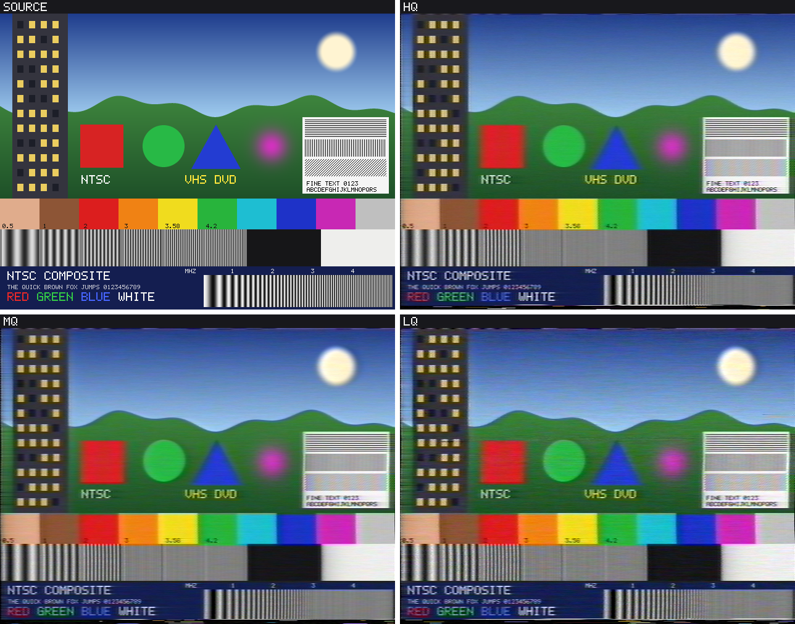
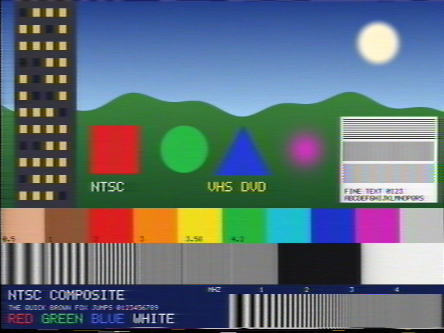
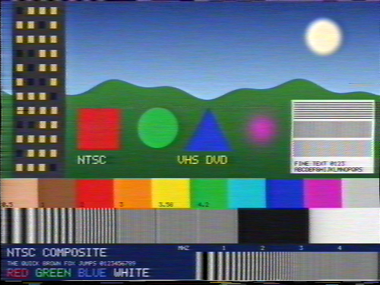
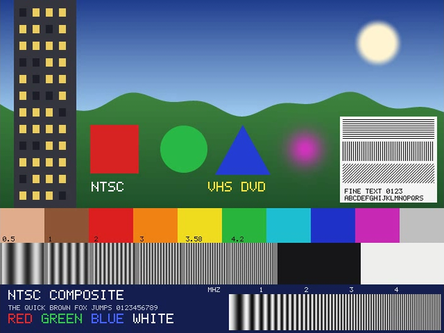
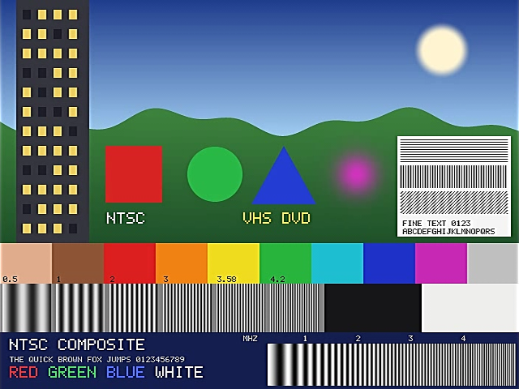
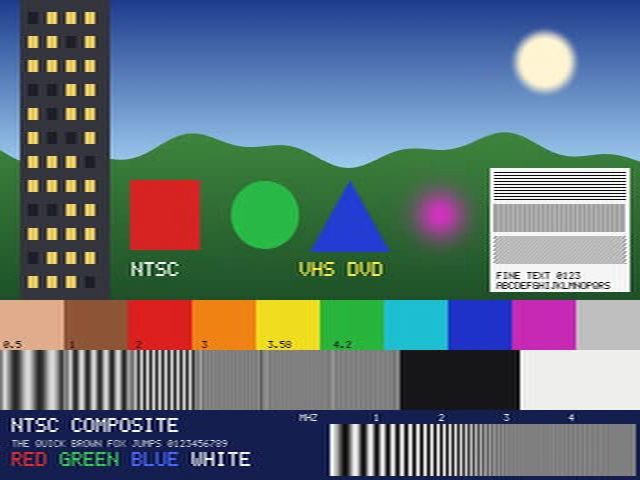
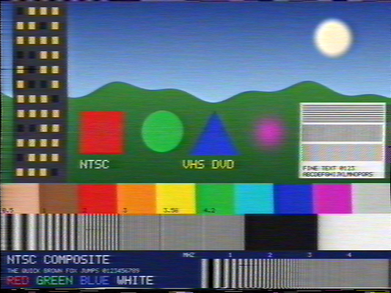
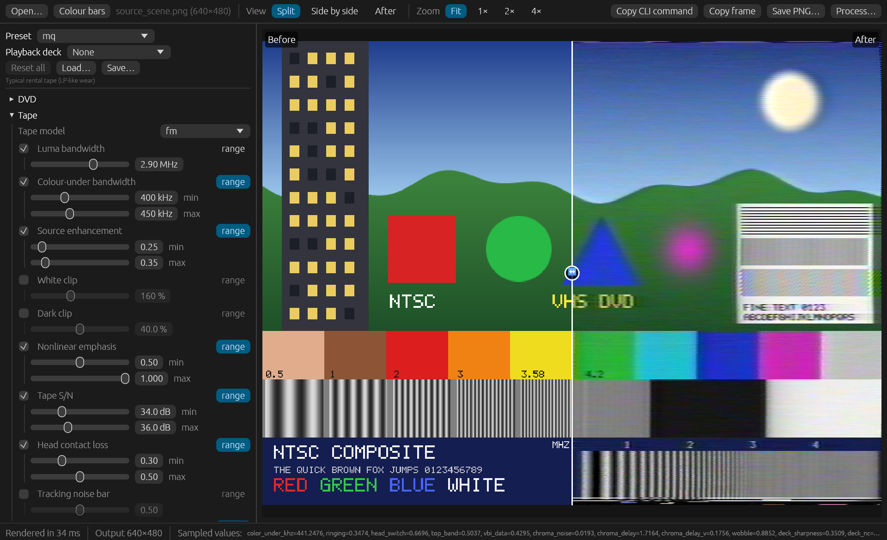

# NTSC Composite Simulator

Realistic NTSC composite, VHS and DVD degradation for images and video, made by simulating the signal chain itself: an NTSC encoder and decoder at 4 × the colour subcarrier, a VHS record and playback model, playback decks and capture cards, and a DVD-Video MPEG-2 path.



*A synthetic test scene (top left) through the `hq`, `mq` and `lq` VHS presets. Every sample image in this README is rendered from that scene; see [Regenerating the images](#regenerating-the-images).*

It is built for people who need believable analog and early-digital artefacts, for example to make paired training data for video restoration models: every setting is seedable, numeric settings take random ranges for batch variation, and video output is lossless by default.

## Contents

- [Features](#features)
- [Building](#building)
- [Quick start](#quick-start)
- [Presets](#presets)
- [Settings reference](#settings-reference)
- [GUI](#gui)
- [Command line](#command-line)
- [How it works](#how-it-works)
- [Accuracy](#accuracy)
- [Output and colour](#output-and-colour)
- [Performance](#performance)
- [Testing](#testing)
- [Regenerating the images](#regenerating-the-images)
- [Third-party licences](#third-party-licences)
- [Changelog](CHANGELOG.md)

## Features

- **NTSC composite signal path**: RGB to YIQ, band-limiting (luma 4.2 MHz, I 1.5 MHz, Q 0.5 MHz), modulation onto the 3.58 MHz subcarrier, a full 525-line frame with sync, blanking and colour burst, and a decoder with a choice of comb filters (adaptive 2D comb by default, 2-sample, 1H line comb, motion-adaptive 3D frame comb, chroma trap). Composite or S-Video connection.
- **VHS tape model**: the original lowpass model (`classic`), and an FM model of the format's record and playback circuits (`fm`, optionally with the FM carrier itself simulated, `rf`): emphasis and clipping, FM noise, colour-under, dropouts, head-contact loss, crosstalk, head switching, time-base errors, dubbing generations.
- **Playback deck and capture card**: noise canceller, line and chroma noise reducers, sharpness control, dropout compensator, line and frame time-base correctors, recursive noise reduction, capture-chip peaking.
- **Reception**: snow, multipath ghosts (several reflections, phase, high-frequency rolloff, slow drift) and attenuation, before or after the tape.
- **DVD-Video path**: mastering (aspect-correct scaling, pre-filter, noise reduction, edge enhancement), 4:2:0, MPEG-2 within the DVD-Video limits via ffmpeg (with soft 3:2 pulldown for film), player decoding and the player's digital, S-Video or composite output; a `dvd-check` command for MPEG-2 streams.
- **Presets** for typical tapes, discs and decks; custom presets as JSON files.
- **Batch-friendly**: whole folders of images or videos, `min..max` ranges sampled per file, `--seed` for exact reproduction, lossless RGB video output.
- **GUI** with live before/after preview, video playback and batch processing; a **CLI** with the same settings.
- **Telecine**: 3:2 pulldown from 24p film to 480i.

## Building

Requirements:

- Rust 1.95 or newer (the GUI needs it; the command-line tool alone builds with older versions).
- [ffmpeg](https://ffmpeg.org/) and ffprobe on your `PATH` for video input and output and for the DVD path. They are only run as separate programs; they are not linked into or shipped with this project. Still images through the analog path do not need them.

```bash
cargo build --release
```

This builds two programs in `target/release/` (`.exe` on Windows):

- `ntsc-composite-simulator`: the command-line tool
- `ntsc-gui`: the GUI

To build only the command-line tool, without the GUI dependencies:

```bash
cargo build --release --no-default-features
```

The crate is also a library (`src/lib.rs`): the encoder, decoder, effects, the shared parameter model in `src/params.rs`, the presets and the processing pipeline in `src/pipeline.rs`. The CLI (`src/main.rs`) and the GUI (`src/bin/ntsc-gui/`) are thin front ends. Every effect parameter (flag name, label, help text, unit, slider range, default, group) is defined once in `src/params.rs`, and both the CLI flags and the GUI controls are generated from that table.

## Quick start

GUI:

```bash
cargo run --release --bin ntsc-gui
# or open a file straight away
target/release/ntsc-gui photo.png
```

Command line:

```bash
# An image through a typical rental tape
ntsc-composite-simulator image photo.png -o vhs.png --preset mq

# A video through a worn EP tape played on an S-VHS deck with a TBC (lossless .mkv output)
ntsc-composite-simulator roundtrip input.mp4 -o output.mkv --preset lq --deck deck-svhs-tbc

# A folder of frames, each with its own random tape wear, reproducible with the seed
ntsc-composite-simulator image ./frames/ -o ./degraded/ --preset mq --tape-snr 30..38 --rf-loss 0.2..0.8 --seed 1
```

## Presets

`--preset NAME` fills in every setting you did not give yourself; flags you pass always win, so a preset is a starting point. `--deck NAME` adds a playback-deck profile; the deck's values win over the preset's where both set something.

All images on this page are 640×480 frames of the same synthetic scene, rendered with seed 7. Open an image for full size; the artefacts are fine-grained and shrink away in the page view.

### VHS

The full VHS look, built on the FM tape model with a typical consumer deck and capture card.

| `hq`: clean SP recording | `mq`: typical rental tape, LP-like wear | `lq`: worn EP tape |
|:---:|:---:|:---:|
|  |  |  |

| Flag | `lq` (worn EP) | `mq` (rental, LP-like) | `hq` (SP) |
|---|---|---|---|
| `--tape-model` | fm | fm | fm |
| `--vhs-luma-bw` | 2.5 | 2.9 | 3 |
| `--color-under-bw` | 400..450 | 400..450 | 400 |
| `--nl-emphasis` | 1 | 0.5..1 | 0..0.5 |
| `--tape-snr` | 30..33 | 34..36 | 37..38 |
| `--dropouts` | 40..100 | 15..30 | 5..15 |
| `--dropout-span` | 2..4 | 1..2 | 1 |
| `--edge-ringing` (source) | 0.15..0.25 | 0.25..0.35 | 0.2..0.3 |
| `--rf-loss` | 0.6..0.9 | 0.3..0.5 | 0.1..0.2 |
| `--tracking-bars` | 0..0.3 | – | – |
| `--luma-crosstalk` | 0.4..0.7 | 0.1..0.3 | – |
| `--ep-interleave` | 0.2..0.6 | – | – |
| `--bw-inversion` | 0.3..0.6 | 0.1..0.2 | – |
| `--head-level-step` | 0.5..1.5 | 0.2..0.8 | 0..0.3 |
| `--generations` | 1..2 | 1 | 1 |
| `--head-switch` | 0.8..1.0 | 0.55..0.7 | 0.35..0.45 |
| `--head-switch-point` | 5.5..7.5 | 6..7 | 6..7 |
| `--flagging` | 0.4..0.6 | 0.25..0.4 | 0.15..0.25 |
| `--top-band` | 0.6..0.8 | 0.4..0.55 | 0.2..0.3 |
| `--vbi-data` | 0.6..0.8 | 0.4..0.55 | 0.25..0.35 |
| `--chroma-noise` | 0.025..0.035 | 0.015..0.025 | 0.008..0.015 |
| `--chroma-noise-bw` | 450 | 450 | 450 |
| `--chroma-crosstalk` | 0.6..0.9 | 0.3..0.5 | 0.15..0.3 |
| `--chroma-phase-noise` | 0 | 0 | 0 |
| `--chroma-vblur` | 1 | 1 | 1 |
| `--chroma-delay` | 2..3 | 1.5..2.5 | 1..2 |
| `--chroma-delay-v` | 1 | 0..1 | 0 |
| `--wobble` | 1..1.5 | 0.5..1 | 0.3..0.6 |
| `--temporal-coherence` | 1 | 1 | 1 |
| `--deck-nc` | 3..5 | 3..5 | 3..5 |
| `--deck-sharpness` | 0.3..0.5 | 0.3..0.5 | 0.3..0.5 |
| `--doc` | luma | luma | luma |
| `--comb` | trap | trap | trap |

Measured with `examples/vhs_measure.rs` (60 IRE peak-to-peak multiburst, flat 50 IRE field, unweighted luma S/N through the decoder): `hq` −3 dB at 2.2 MHz and −10 dB at 2.7 MHz on S-Video (2.0 / 2.5 MHz composite), S/N 45 dB; `mq` 2.2 / 2.8 MHz, 42 dB; `lq` 1.1–2.0 / 1.8–2.6 MHz (worn, varies with the tape's bands and dubbing), 37 dB. The tape channel alone (no deck noise canceller or sharpening) is −3 dB at 2.25 MHz and −10 dB at 3.0 MHz for `hq`, the 240 TVL of SP decks; deck S/N specifications (43–45 dB SP, about 41 dB EP) are measured with the deck's noise canceller on.

### VHS legacy

`legacy-lq`, `legacy-mq` and `legacy-hq` are the original tape-path settings and nothing else: the `classic` lowpass tape model with luma noise, dropouts, head-wear smear and a rightward trail. With the same `--seed` they reproduce the output of earlier versions byte for byte (locked by the test suite), the same as passing their seven flags by hand together with `--comb 2sample`. They pin the 2-sample comb, the decoder default when they were made; the default is now `2d`.

| Flag | `legacy-lq` | `legacy-mq` | `legacy-hq` |
|---|---|---|---|
| `--vhs-luma-bw` | 1.6 | 3 | 3 |
| `--color-under-bw` | 400..450 | 400..450 | 300..400 |
| `--edge-ringing` | 0.3..0.4 | 0.25..0.35 | 0.2..0.3 |
| `--luma-noise` | 0.025..0.035 | 0.02..0.03 | 0.015..0.025 |
| `--tape-dropout-rate` | 1 | 0..1 | 0 |
| `--head-smear` | 0.2..0.3 | 0.15..0.2 | 0.1..0.15 |
| `--tape-trail` | 0.75..0.9 | 0.6..0.75 | 0.5..0.7 |
| `--comb` | 2sample | 2sample | 2sample |

### DVD

The DVD presets select the DVD path (`--format dvd`, see [DVD-Video path](#dvd-video-path)). The images below use `--dvd-output-size square` (640×480) so they line up with the others; by default the output is the stored 720×480 frame. The scene is clean and synthetic, which is easy to compress, so compression artefacts are milder than on grainy film; the mastering stages (edge enhancement, pre-filter, half-D1 size) show clearly.

| `dvd-hq` | `dvd-mq` | `dvd-mq-ee` |
|:---:|:---:|:---:|
|  |  |  |
| **`dvd-lq`** | **`dvd-interlaced`** | |
|  |  | |

| Preset | Frames | Size | Avg / peak Mbit/s | Other |
|---|---|---|---|---|
| `dvd-hq` | 23.976p, soft pulldown | 720×480 | 7–8 / 9.5 | two-pass |
| `dvd-mq` | 23.976p, soft pulldown | 720×480 | 5–6 / 8–9 | |
| `dvd-mq-ee` | 23.976p, soft pulldown | 720×480 | 5–6 / 8–9 | edge enhancement 0.5–0.7, DNR 0.3–0.5 |
| `dvd-lq` | 23.976p, soft pulldown | 352×480 | 3–4 / 6–7 | low-rate matrices, pre-filter 0.3–0.5 |
| `dvd-interlaced` | 29.97i TFF | 720×480 | 5–6 / 8–9 | video-sourced |

### Playback decks

Deck profiles combine with any preset. The images show `lq` with each deck, rendered as a still shot held for ten frames of video (the tenth frame is shown), so the deck's recursive noise reduction and the 3D comb have the frames they need.

| `lq`, no deck profile | `lq --deck deck-basic` |
|:---:|:---:|
|  |  |
| **`lq --deck deck-svhs-tbc`** | **`lq --deck deck-edit`** |
|  |  |
| **`lq --deck deck-vhs-decode`** | |
|  | |

| Profile | What it is | Settings |
|---|---|---|
| `deck-basic` | ordinary consumer VCR: composite output, no TBC | `--deck-nc 4 --deck-sharpness 0.4 --doc luma` |
| `deck-svhs-tbc` | high-end S-VHS deck with line and frame TBC, recursive noise reduction, S-Video out (3D comb for composite captures) | `--line-tbc 0.9 --frame-tbc 1 --deck-dnr 0.5 --comb 3d --video-out svideo --deck-nc 5 --deck-ynr 1 --deck-cnr 1 --deck-sharpness 0.2 --doc luma` |
| `deck-edit` | edit mode as on pro decks for dubbing (e.g. JVC BR-S422): no sharpening, noise canceller and colour noise reducer off | `--deck-sharpness 0 --deck-nc 0 --deck-cnr 0` |
| `deck-vhs-decode` | an RF capture decoded by vhs-decode and exported with tbc-video-export: no VCR playback electronics; every line re-timed from its own sync and the fields aligned in software; separate luma and chroma files, decoded like S-Video; luma dropouts corrected from neighbouring lines (colour muted here, as the closest option); vhs-decode's own 1H chroma comb is on by default, as in the tape presets; sharpness 0 | `--line-tbc 1 --frame-tbc 1 --video-out svideo --deck-nc 0 --deck-ynr 0 --deck-cnr 0 --deck-sharpness 0 --deck-dnr 0 --doc luma` |

The `lq` preset already includes a typical consumer deck (noise canceller, sharpness, luma dropout compensator), so `deck-basic` changes it only slightly. `deck-edit` leaves source enhancement (`--edge-ringing`) and the line noise reducer as they are set. `deck-vhs-decode` keeps the tape (the preset's tape model, wear, head switching and dropouts) and replaces only the playback deck; the head-switching rows stay, as in vhs-decode output, but the lines after the switch are re-timed. Its tape model stays `fm`: vhs-decode demodulates the RF in software, and `--tape-model rf` (the FM channel itself, about four times slower) can be added for the RF channel's own clicks and dropout streaks.

### Preset files

`--preset-file PATH` reads a JSON preset; the GUI's **Save…** writes the same format. Its values fill in settings not given on the command line, before `--deck` and `--preset`. Values are written as on the command line: a number, a `"min..max"` string, `true`/`false` for switches, or text; `seed` is optional.

```json
{
  "name": "My tape",
  "params": {
    "vhs-luma-bw": "1.6",
    "color-under-bw": "400..450",
    "chroma-delay": 2,
    "ghost-dynamic": true
  },
  "seed": 42
}
```

## Settings reference

Every setting is a command-line flag and a control in the GUI. Numeric settings take a single value or a `min..max` range. A setting that is not given is off unless a default is listed. Settings marked *FM* need `--tape-model fm` or `rf`. The groups follow the signal chain, as in the GUI.

### DVD

Only used with `--format dvd`.

| Flag | What it simulates and what it looks like | Values |
|---|---|---|
| `--format` | Signal path: `analog` (NTSC / VHS) or `dvd` (mastering, MPEG-2, player). Tape and reception effects only apply on the DVD path when set explicitly and the player output is analog. | `analog` (default), `dvd` |
| `--dvd-size` | Coded frame size: full D1, 704 wide, half D1 (long-play discs, soft), or SIF (progressive, VCD-like). | `720x480` (default), `704x480`, `352x480`, `352x240` |
| `--dvd-aspect` | Display aspect flag; 16:9 is anamorphic (squeezed on disc). Sources of another aspect are letterboxed or pillarboxed. | `4:3` (default), `16:9` |
| `--dvd-rate` | `interlaced`: 29.97 fps, top field first (video-sourced discs). `film`: 23.976 fps progressive with soft 3:2 pulldown flags. | `interlaced` (default), `film` |
| `--dvd-bitrate` | Average video bit rate (VBR). Lower rates give blocking, mosquito noise around edges and smeared texture. | 1–9.8 Mbit/s, default 6 (7–8 good film, 3–4 budget) |
| `--dvd-maxrate` | Peak bit rate; lower peaks starve complex scenes. | 2–9.8 Mbit/s, default 9.5 |
| `--dvd-gop` | Maximum pictures per closed GOP (M = 3). ffmpeg ends a closed GOP on a P picture, so the length is the largest 3k+1 at or below this (15 gives 13). | 1–18, default 15 |
| `--dvd-matrix` | Quantiser matrices: MPEG-2 defaults, or steeper low-rate matrices (softer, fewer blocks at low rates). | `standard` (default), `lowrate` |
| `--dvd-2pass` | Two-pass VBR: better bit distribution over the whole clip (slower). | switch |
| `--dvd-ee` | Mastering edge enhancement: bright and dark outlines several pixels wide, the classic DVD halo. | 0–1 (typical 0.5) |
| `--dvd-dnr` | Mastering noise reduction: edge-preserving smoothing that wipes out grain and fine texture. | 0–1 (typical 0.5) |
| `--dvd-prefilter` | Pre-compression luma lowpass, from about 6 MHz down to about 3.8 MHz of horizontal detail. | 0–1 (typical 0.5) |
| `--dvd-cue` | Player chroma upsampling error: interlaced 4:2:0 colour upsampled as if progressive; jagged, streaky colour edges. | 0–1 (typical 1) |
| `--dvd-output` | Player output: the decoded frames (like a rip), or S-Video / composite through the NTSC decoder (composite adds cross-colour and dot crawl). | `digital` (default), `svideo`, `composite` |
| `--dvd-output-size` | The stored frame with non-square pixels, or the active area scaled to square pixels (640×480, 854×480 for 16:9). | `native` (default), `square` |
| `--dvd-frame-type` | For stills: which decoded picture type to return (B pictures are two thirds of a DVD and the most coarsely quantised). | `b` (default), `p`, `i` |
| `--dvd-keep-mpeg2` | Also save the MPEG-2 stream: `.m2v` elementary stream, `.vob`/`.mpg` DVD program stream. | file path |

### Tape

| Flag | What it simulates and what it looks like | Values |
|---|---|---|
| `--tape-model` | `classic`: the original lowpass tape path. `fm`: the VHS record and playback circuits (band-filter luma/chroma split, record and playback luma lowpass, colour-under filter, emphasis). `rf`: as `fm`, with the FM carrier simulated, so noise, sparkles, dropout streaks and crosstalk beats come out of the channel (slower). | `classic` (default), `fm`, `rf` |
| `--vhs-luma-bw` | Luma bandwidth. Classic: a lowpass cutoff. FM: the −10 dB point of record + playback. Lower values blur fine horizontal detail. | 0.5–4.2 MHz (SP 3.0, LP/EP 2.8–2.9, worn lower) |
| `--color-under-bw` | Colour-under chroma bandwidth; lower values smear colour sideways past edges. | 100–1000 kHz (typical 300–500) |
| `--edge-ringing` | Source enhancement already on the tape (broadcast filters, telecine aperture correction, duplicator enhancers): bright and dark halos beside sharp edges. With the FM model it is recorded through the tape path. | 0–3 (typical 0.3) |
| `--white-clip` | *FM*. The recorder's white clip after pre-emphasis, in % of the sync-to-white span. Large sharp edges overshoot it and come out softened with a trail; higher keeps bright edges crisper. | 120–220 %, default 160 (HQ decks 170–200) |
| `--dark-clip` | *FM*. The dark clip after pre-emphasis; lower values leave a lighter trail after bright objects. | 20–60 %, default 40 |
| `--nl-emphasis` | *FM*. Nonlinear emphasis (always in EP, deck-dependent in SP): noise on flat areas drops by up to about 7 dB while noise beside large edges stays. | 0–1 (typical 1) |
| `--tape-snr` | *FM*. Tape noise S/N before the deck's noise reduction. Added in the emphasised FM domain, so it comes out as fine, horizontally streaky grain, about equal in dark and bright areas. | 25–55 dB (37–38 SP, 34–36 LP, 30–33 worn EP) |
| `--rf-loss` | *FM*. Head-to-tape contact loss in soft bands that drift down the picture: stronger grain, white and black sparkles with tails, slightly softer detail, weaker colour. | 0–1 (typical 0.4) |
| `--tracking-bars` | *FM*. A tracking noise bar: a band of heavy noise, sparkles and lost colour, 10–25 rows high, rolling slowly. | 0–1 (typical 0.5) |
| `--luma-crosstalk` | *FM*. Luma crosstalk from the neighbouring track: faint low-frequency beat patterns where the two fields differ, e.g. on motion. | 0–1, 1 = −20 dB (typical 0.5) |
| `--ep-interleave` | *FM*. EP carrier-interleave residue: a DC offset between the two fields, faint line-by-line stripes and 30 Hz flicker. | 0–1.1 IRE (typical 0.5) |
| `--bw-inversion` | *FM*. Worn heads lose the carrier of bright, emphasised edges: black specks with a short tail after strong dark-to-bright edges. | 0–1 (typical 0.3) |
| `--head-level-step` | *FM*. Level difference between the two video heads: the fields differ slightly in brightness, a faint line-pair pattern. | 0–5 % (typical 1) |
| `--generations` | *FM*. Tape generations; each dub adds its own noise, dropouts and emphasis clipping. | 1–4, default 1 (1 = original) |
| `--head-smear` | Classic model. Worn-head symmetric luma blur that varies in bands down the frame (no real deck circuit blurs like this; `--rf-loss` is the physical model). | 0–1 (typical 0.2) |
| `--tape-trail` | Classic model. Causal rightward luma smear on all luma, noise included. In the FM model trails come from the emphasis clipping instead. | 0–1 (typical 0.6) |

### Colour

| Flag | What it simulates and what it looks like | Values |
|---|---|---|
| `--chroma-noise` | Colour-under chroma noise: horizontal colour blotches in flat areas. | 0–0.1 std dev (subtle 0.01–0.03, heavy 0.06) |
| `--chroma-noise-bw` | Bandwidth of the colour-under noise. Unset: the original 150 kHz noise (blotches three times longer). | 100–1000 kHz (typical 450) |
| `--chroma-crosstalk` | Adjacent-track colour crosstalk, alternating in sign line by line. The 1H comb (`--chroma-vblur 1`) cancels it except at vertical colour changes, which get faint fringes; without the comb it shows as line-by-line colour stripes. | 0–1, 1 = −20 dB (SP about 0.2–0.3) |
| `--chroma-phase-noise` | Per-line hue jitter; lines flicker slightly in hue. | 0–15° (subtle 1–3) |
| `--chroma-vblur` | Playback 1H chroma comb: colour mixed with the line above, softening colour edges vertically. Real decks use 1. | 0–1 |
| `--chroma-delay` | Horizontal chroma delay relative to luma: colour sits beside its object. | −4–8 px at 640 wide (typical 1–4) |
| `--chroma-delay-v` | Vertical chroma delay in field lines (1 field line = 2 output rows): colour sits below its object. | 0–3 (typical 0–1) |

### Noise and dropouts

| Flag | What it simulates and what it looks like | Values |
|---|---|---|
| `--luma-noise` | Classic model. Luminance-dependent tape noise, stronger in dark areas. | 0–0.1 (typical 0.02–0.10) |
| `--tape-dropout-rate` | Classic model. Dropouts per frame: short white streaks or repeated line segments. Real tapes have well under 0.1 per frame. | 0–30 per frame |
| `--dropouts` | *FM*. Dropouts per minute as the industry counts them (≥ 15 µs, ≥ 16 dB), plus shorter ones in proportion: white or black streaks with a soft tail, or with a compensator a colourless repeat of the line above. | 0–200 per minute (typical 5–30) |
| `--dropout-span` | *FM*. Most consecutive fields one tape defect hits; on EP the same dropout repeats in the next fields. | 1–4, default 1 (1 SP, 2 LP, 3–4 EP) |
| `--tape-dropout-len` | Average dropout length. | 1–60 µs, default 15 |
| `--doc` | Dropout compensator. `composite`: copies the whole line above, colour included (its colour decodes in the complementary hue). `luma`: copies the luma and mutes the colour, as real decks do. `off`: every dropout is a white or black streak. | `composite` (default), `luma`, `off` |

### Timing

| Flag | What it simulates and what it looks like | Values |
|---|---|---|
| `--jitter` | Random horizontal line jitter: lines jump sideways independently. | 0–3 subcarrier cycles std dev (typical 0.1–1.0) |
| `--wobble` | Correlated time-base wobble from tape stretch, capstan flutter and drum speed: vertical edges bend in slow waves. The burst moves with the line, so hue is kept. | 0–6 px peak (typical 0.5–3) |
| `--wobble-rate` | Wobble frequency scale; 1 = periods of about 20–300 lines. | 0.1–4, default 1 |
| `--v-jitter` | Vertical bounce: the picture jumps up and down by whole lines from frame to frame. A frame TBC removes it. | 0–4 rows std dev (typical 1) |
| `--head-switch` | Head-switching noise at the bottom of each field: a displaced switch line with a switching transient, then near-black lines with bright noise streaks. Stable over a tape, with per-field flicker and occasional sudden jumps. | 0–1 (typical 0.6) |
| `--head-switch-lines` | Active lines per field torn at full strength. | 1–20, default 3 (6 rows at 480) |
| `--head-switch-point` | Where the heads switch, in lines before vertical sync: sets how many rows tear (about 2 × point − 5.5), independent of strength. Replaces `--head-switch-lines`. | 4–9 (the format allows 6.5 ± 1.5) |
| `--head-switch-after` | What the lines after the switch show: `black` (signal lost, light streaks) or `picture` (shifted sideways with a small level step, the common case on healthy tapes). | `black` (default), `picture` |
| `--flagging` | Top-of-field skew: the head switch's time-base step carried into the next field by a slow PLL, so the top lines bend sideways and straighten over about 30 lines. Both fields bend the same way; the heads' phase error adds a few tens of ns between them. A line TBC removes it. | 0–1, 1 ≈ 12 px at the top line (typical 0.5) |
| `--top-band` | Faint blue/purple chroma bands on the first lines of each field, as the deck's chroma loop settles. | 0–1 (typical 0.4) |
| `--vbi-data` | Closed-caption data on lines 21/284: a row of short light dashes near the top. | 0–1 (typical 0.5) |

### Reception

| Flag | What it simulates and what it looks like | Values |
|---|---|---|
| `--noise` | Gaussian RF noise (snow). | 0–0.3 (0.05 subtle, 0.2 heavy) |
| `--ghost` | Primary multipath ghost: a faint delayed copy of the picture to the right. | 0–1 amplitude (typical 0.2) |
| `--ghost-delay` | Primary ghost delay; larger moves it further right. | 0–20 µs, default 2 |
| `--ghost-phase` | Ghost phase; 180 = polarity inversion, a negative ghost. | 0–360°, default 0 |
| `--ghost-rolloff-mhz` | Ghost high-frequency rolloff; lower makes the ghost softer. | 0.5–4.2 MHz (typical 3) |
| `--ghost-dynamic` | Slow drift of the ghost amplitude (swaying trees, passing vehicles). | switch |
| `--ghost-dynamic-rate` | Drift rate. | 0.05–5 Hz, default 0.5 |
| `--ghost-multi` | Extra ghosts as `amp,delay_us,phase_deg` triples separated by `;`; each value may be a range. | e.g. `"0.1..0.3,2.0..5.0,0..180;0.08,7.5,0"` |
| `--reception-before-tape` | Apply snow, ghosts and attenuation before the tape path, as on an off-air recording (the snow is then band-limited by the tape). Off: after the tape, like a VCR's RF output into a TV. | switch |
| `--attenuation` | Signal attenuation: lower contrast and saturation towards blanking. | 0–1 (typical 0.1) |

### Playback deck and capture

| Flag | What it simulates and what it looks like | Values |
|---|---|---|
| `--line-tbc` | Line time-base corrector: re-times every line from its sync, removing most jitter, wobble, top skew and the displacement after the head switch (the switching noise line stays). | 0–1 (typical 1) |
| `--frame-tbc` | Frame TBC / frame synchroniser: holds the picture vertically, removing `--v-jitter`. | 0–1 (typical 1) |
| `--deck-dnr` | Recursive, motion-adaptive temporal noise reduction: cleans luma and colour noise in still areas; moving edges pass, faint moving detail can leave a short soft trail. Needs consecutive frames, so it does nothing on single images. | 0–1 (typical 0.5) |
| `--deck-nc` | The luma noise canceller (coring) nearly every VCR has: detail under the threshold above 1 MHz goes with the noise; flat areas look clean and slightly waxy. | 0–15 IRE (typical 4–10) |
| `--deck-ynr` | HQ decks' recursive line noise reducer: small line-to-line differences averaged, strong vertical changes pass. | 0–1 (typical 1) |
| `--deck-cnr` | HQ decks' recursive chroma noise reducer: fewer colour blotches, a little more vertical colour smear. | 0–1 (typical 1) |
| `--deck-sharpness` | The deck's picture control after the noise canceller: positive adds a short peaker around 2.4 MHz (up to +6 dB, thin halos, lifted grain), 0 is edit mode, negative softens. | −1–1 |
| `--capture-peaking` | The capture chip's luma peaking gain; on VHS it mostly lifts noise above the tape bandwidth (crisper grain, thin halos). | 0–2, 1 = +6 dB (SAA7113 about 0.25) |
| `--capture-peaking-mhz` | Its centre frequency. | 1.5–4.5 MHz, default 2.6 |
| `--comb` | Luma/chroma separation in the TV or capture card (composite only). `2d` (default): adaptive 3-line comb as in most TVs and monitors from the late 1980s on (line above or below, whichever matches, 2-sample fallback): clean colour bars, no dot crawl on still vertical edges, no hanging dots; the closest to a decent receiver. `2sample`: rainbow on fine detail, soft luma (−3 dB at 1.8 MHz); the default of earlier versions, kept by the `legacy-*` presets. `1h`: line comb, less rainbow but hanging dots on colour edges. `3d`: motion-adaptive frame comb, cleanest on still areas. `trap`: chroma notch (± 0.6 MHz) as capture chips use for VCR input, luma to about 2.9 MHz. | `2d` (default), `2sample`, `1h`, `3d`, `trap` |

### Input, decoder and output

| Flag | What it simulates and what it looks like | Values |
|---|---|---|
| `--temporal-coherence` | How slowly the tape state drifts in video. 0 re-rolls head-smear bands, wobble, head-switch shape and top-band tint every frame; 1 makes them drift slowly like a real tape. Chroma noise stays random. | 0–1 |
| `--video-out` | Connection to the TV or capture card: `composite` (one wire, comb filter, cross-colour and dot crawl) or `svideo` (separate luma and colour wires, no comb, no cross-colour). | `composite` (default), `svideo` |
| `--input-matrix` | Colour matrix for converting source video to RGB. | `auto` (default), `601`, `709` |
| `--input-range` | Value range of source video. | `auto` (default), `limited`, `full` |
| `--legacy-burst-phase` | Decode with the inverted burst phase estimate of older builds (doubles burst phase errors into per-line hue noise). With `--seed`, reproduces output of builds before fb47e5c. | switch |

## GUI



- **Settings panel** (left): pick a **Preset** (VHS, DVD, VHS legacy, or your own) and a **Playback deck** profile, then fine-tune in collapsible groups that follow the signal chain (the groups of the [settings reference](#settings-reference)). Every setting has an on/off box, a slider with its unit, a tooltip, and a **range** toggle that turns the slider into min/max. Editing marks the preset as *modified*; **Reset group** and **Reset all** go back to the preset. **Save…** / **Load…** store presets as JSON, the format of `--preset-file`.
- **Preview** (centre): opens with SMPTE colour bars. **Open…** or drag and drop an image, a video, or a preset `.json`. Views: **Split** (drag the divider), **Side by side**, **After**. Zoom: **Fit**, **1×**, **2×**, **4×** (nearest neighbour), or scroll to zoom from 0.25× to 16× about the cursor; drag to pan, double-click to centre. DVD frames are shown at their display aspect.
- **Live rendering** runs in the background shortly after each change, always on the newest settings. The status bar shows the render time and the **sampled values** the ranges resolved to. **Seed** and **Reroll** change the random draws; **Frame** steps through frames to see per-frame effects and, with temporal coherence on, the slow drift of the tape state.
- **Playback** (videos): **Play** / **Pause** (or Space) plays the processed video in the preview. Frames go through the same library code as the CLI with their real frame numbers, so a shown frame matches the same frame of a `roundtrip` with the same settings and seed. By default playback keeps to the source frame rate and leaves out late frames; **Every frame** shows all of them, slower than real time if needed. With the deck noise reduction on, playback cannot skip frames and slows down instead. **Loop** restarts at the end; changed settings apply from the next frame. The DVD path cannot be played (it encodes the whole clip first).
- **Toolbar**: **Copy CLI command** copies the equivalent `ntsc-composite-simulator` command line, **Save PNG…** saves the processed preview, **Copy frame** (Ctrl+C) puts it on the clipboard, and **Process…** runs the current settings over a file or a folder (images, or videos with lossless or lossy output and optional telecine) with a progress bar and **Cancel**.

Start-up options: `ntsc-gui [FILE] --preset NAME --deck NAME --time SECONDS --view split|side|after --zoom fit|1|2|4 --process --screenshot OUT.png` (`--screenshot` saves a window screenshot once the preview has rendered, then exits).

**Crash reports**: the GUI has no console, so panics and failed memory allocations are appended to `%LOCALAPPDATA%\ntsc-simulator\crash.log` on Windows (`~/.local/share/ntsc-simulator/crash.log` elsewhere) with the thread, message, source location and a backtrace. A crash on the UI thread also shows a message box with the log's path. A panic in a background job (preview, playback, Process…) is logged and shown as an error instead of closing the program. Release builds keep line tables (on Windows `ntsc_gui.pdb` next to the `.exe`) so the backtrace names files and lines; keep the `.pdb` with the `.exe`.

## Command line

```
ntsc-composite-simulator <COMMAND> [OPTIONS]
```

| Command | What it does |
|---|---|
| `image INPUT -o OUTPUT` | One image, or every image in a folder (OUTPUT is then a folder). Output size defaults to the input size; `--width`/`--height` change it. |
| `roundtrip INPUT -o OUTPUT` | One video, or every video in a folder, through the chain (default output `output.mkv`, 640×480). Audio is copied across. |
| `colorbars -o OUTPUT` | SMPTE colour bars through the chain; `--save-source` also saves the clean pattern. |
| `extract-frame INPUT -o frame.png --time T` | One frame of a video as an RGB PNG, with the same colour conversion as `roundtrip`, no effects. |
| `dvd-check FILE` | Checks an MPEG-2 stream (`.m2v`, `.vob`, `.mpg`) against the DVD-Video NTSC video limits. |

Options shared by `image`, `roundtrip` and `colorbars`: every setting in the [settings reference](#settings-reference), and

| Option | Meaning |
|---|---|
| `--preset NAME` | Built-in preset (alias `--vhs-preset`): `lq`, `mq`, `hq`, `legacy-lq`, `legacy-mq`, `legacy-hq`, `dvd-hq`, `dvd-mq`, `dvd-mq-ee`, `dvd-lq`, `dvd-interlaced` |
| `--deck NAME` | Playback-deck profile: `deck-basic`, `deck-svhs-tbc`, `deck-edit` |
| `--preset-file PATH` | JSON preset |
| `--seed N` | Seed for every random choice (sampled ranges and per-frame effects). In batch mode each file gets its own seed derived from it. |
| `--width`, `--height` | Output size (`roundtrip` and `colorbars` default to 640×480) |
| `--comb-1h` | Same as `--comb 1h` |

Order of precedence: flags you give, then the preset file, then `--deck`, then `--preset`.

`roundtrip` only:

| Option | Meaning |
|---|---|
| `--telecine` | 3:2 pulldown from 24p film to 29.97 fps interlaced, top field first |
| `--lossy` | x264 4:2:0 output at `--crf` instead of the lossless default |
| `--crf N` | x264 quality with `--lossy` (0 lossless … 51 worst, default 17) |
| `--x264-preset NAME` | x264 speed preset for `--lossy` and lossless `.mp4` (default `fast`) |
| `--threads N` | Worker threads (default: all logical cores) |

Run `ntsc-composite-simulator <COMMAND> -h` for the full list with help text.

### Ranges and batches

Every numeric setting accepts `min..max`. Each file of a batch gets a value drawn from the range (one draw per file, kept for all its frames), which gives natural variation across a dataset. The drawn values are logged to stderr, and with `--seed` the whole batch can be reproduced.

```bash
# Each image gets a different noise level
ntsc-composite-simulator image ./frames/ -o ./out/ --noise 0.02..0.15 --seed 3

# A batch of tapes from clean SP to worn EP
ntsc-composite-simulator roundtrip ./videos/ -o ./processed/ --preset mq \
  --tape-snr 31..38 --rf-loss 0.1..0.8 --dropouts 5..80 --head-switch 0.4..1.0
```

### More examples

```bash
# Weak off-air reception, recorded on tape
ntsc-composite-simulator roundtrip input.mp4 -o output.mkv --preset hq \
  --noise 0.05 --ghost 0.25 --ghost-delay 1.5 --ghost-phase 180 --reception-before-tape

# Several reflections with slow drift and soft ghosts
ntsc-composite-simulator roundtrip input.mp4 -o output.mkv \
  --ghost 0.35 --ghost-delay 2.0 --ghost-phase 180 --ghost-dynamic \
  --ghost-multi "0.20,5.0,0;0.12,9.5,180;0.06,15.0,0" --ghost-rolloff-mhz 2.5 --noise 0.04

# Typical tape without the closed-caption dashes, captured over S-Video
ntsc-composite-simulator image photo.png -o vhs.png --preset mq --vbi-data 0 --video-out svideo

# FM tape model built by hand: SP tape, a few dropouts, consumer deck, capture-card chroma trap
ntsc-composite-simulator roundtrip input.mp4 -o output.mkv \
  --tape-model fm --vhs-luma-bw 3 --tape-snr 37 --dropouts 20 --rf-loss 0.3 \
  --doc luma --deck-nc 4 --deck-sharpness 0.4 --comb trap

# Film title on DVD, played over composite, keeping the MPEG-2 program stream
ntsc-composite-simulator roundtrip film.mp4 -o dvd.mkv --format dvd --dvd-rate film \
  --dvd-ee 0.6 --dvd-dnr 0.4 --dvd-output composite --dvd-keep-mpeg2 movie.vob
ntsc-composite-simulator dvd-check movie.vob
```

## How it works

### Signal path

| Parameter | Value |
|---|---|
| Sample rate | 14 318 180 Hz (4 × fsc) |
| Colour subcarrier | 3 579 545 Hz |
| Frame rate | 29.97 fps |
| Lines per frame | 525 (480 visible) |
| Samples per line | 910 |

Encoding: RGB to YIQ; band-limit luma (4.2 MHz), I (1.5 MHz) and Q (0.5 MHz) with FIR filters; modulate I/Q onto the subcarrier; build the 525-line frame with sync, blanking and burst; vestigial sideband filtering. Decoding: separate luma and chroma with the selected comb, detect the burst phase, demodulate I and Q by product detection, lowpass the chroma, convert back to RGB.

The effects run on the encoded signal between encoder and decoder, in signal-chain order: reception (unless before the tape), the tape path, the deck's processing, then the connection (composite or S-Video) and the decoder with its comb and capture peaking. The deck noise reduction runs last, on the decoded frames in order. Each newer stage draws from its own random stream, so turning one on never changes the others.

### VHS: record and playback

`--tape-model fm` follows the circuits of the VHS format, from the format standard and service literature:

- **Record**: the recording deck's luma/chroma split (a band filter of ± 0.6 MHz around the subcarrier, so luma detail inside it is recorded as cross-colour), the colour-under filter, the record luma lowpass, optional nonlinear emphasis, the main pre-emphasis (1.3 µs, ×5 shelf, each tape's record and playback networks within the format's ± 0.05 µs / ± 0.3 tolerance) and the white and dark clips. Large sharp edges overshoot the clips, so after de-emphasis they come out softened with a causal trail, while small edges come back intact.
- **Tape**: FM noise in the emphasised domain (rising with frequency after de-emphasis), dropouts counted per minute (mostly 1–2 µs, none under 0.5 µs, white or black streaks with de-emphasis tails, spanning several fields on EP), head-contact RF loss in drifting bands, tracking noise bars, luma crosstalk beats, the EP interleave residue, black/white inversion after bright edges, a level step between the heads, and dubs.
- **Playback**: the demodulator's lowpass (record + playback −3 dB at 0.66 × and −10 dB at 1.0 × `--vhs-luma-bw`), de-emphasis and nonlinear de-emphasis; dropout compensation per `--doc`.
- **Chroma**: colour-under (heterodyned down to 629 kHz, band-limited, back up); in the playback chroma path the chroma is demodulated per line into that line's burst frame, where colour-under noise, crosstalk, hue jitter, the 1H comb and the horizontal and vertical chroma delay are applied; only the change is remodulated, so luma is untouched.
- **Timing**: time-base wobble (three sinusoids along the track, the same in both fields, plus a small mean-reverting random walk in scan order, burst moving with the line), head switching (a time-base jump on the last lines of each field, a switching transient, then black or the displaced picture), top-of-field skew, top-of-field chroma bands, and an EIA-608 caption waveform on lines 21/284 written before the tape path.

`--tape-model rf` goes a step further and simulates the FM carrier itself (modulated at 3.4–4.4 MHz at 8 × fsc, record highpass and head/tape lowpass, RF noise, limiter and demodulator), so noise, sparkles, dropout streaks and crosstalk beats come out of the channel. It costs about four times as much per frame.

`classic` is the original model kept for the legacy presets: a luma lowpass, colour-under, unsharp-mask ringing, luminance-dependent noise, dropouts with a line-hold compensator, a banded head-wear blur and a causal one-pole trail.

### Multipath ghosts

Each ghost is an independent delayed copy of the direct signal (not of the already-ghosted signal), with sub-sample delay by interpolation, a one-pole high-frequency rolloff per ghost, a phase rotation (exact at 0° and 180°, the common real cases) and an optional slow amplitude drift from a sum of sinusoids.

### DVD-Video path

`--format dvd` replaces the analog chain:

1. **Mastering**: the source is fitted into the 704-sample active area (8 samples of black each side in a 720-wide frame) with a Lanczos-3 filter and the correct sample aspect (10:11 for 4:3, 40:33 for 16:9), letterboxed or pillarboxed if needed. Optional pre-filter, noise reduction and edge enhancement.
2. **4:2:0**: BT.601 studio-range Y'CbCr; chroma subsampled per field for interlaced pictures and per frame for progressive ones, with MPEG-2 chroma siting.
3. **MPEG-2 encode** with ffmpeg's `mpeg2video`: Main Profile @ Main Level, 720×480 / 704×480 / 352×480 / 352×240, 29.97 fps interlaced top field first or 23.976 fps progressive with soft 3:2 pulldown, 4:3 or 16:9 flags, closed GOPs with M = 3 and at most 18 pictures, VBR at `--dvd-bitrate` average and `--dvd-maxrate` peak (≤ 9.8 Mbit/s), VBV buffer 1 835 008 bits, 9-bit intra DC, optional low-rate matrices and two-pass. ffmpeg cannot write pulldown flags, so the soft pulldown (repeat_first_field / top_field_first in the 2:3 pattern) is patched into the stream by this program.
4. **Player decode**: chroma upsampled per field for interlaced pictures; `--dvd-cue` blends in the progressive upsampling many players used.
5. **Player output**: digital, or S-Video / composite through the NTSC encoder and decoder (film gets 3:2 pulldown on the analog outputs).

Still images are encoded as a short sequence (one GOP plus a few pictures) so they get real I, P and B pictures; `--dvd-frame-type` picks which is returned. `dvd-check` reports profile and level, chroma format, frame size, frame rate (and soft pulldown), aspect flag, maximum GOP length, closed GOPs, VBV buffer size, header and peak 1-second bit rate and field order, plus ffprobe's view of the stream.

## Accuracy

What is modelled on published figures and what is estimated:

- **Calibrated against specifications**: the NTSC signal timing and bandwidths; the VHS format's emphasis network, clip levels, switch point, colour-under frequency and caption waveform; the FM model's luma response (`hq` reaches the 240 TVL of SP decks, see the measurements under [VHS](#vhs)) and S/N (tape noise set so that, with the deck's noise canceller, it lands near deck specifications); the DVD-Video limits on the MPEG-2 stream.
- **Estimated from typical behaviour, not a specific machine**: wear effects (RF loss bands, crosstalk strength, dropout shapes, head switching appearance), the deck and capture-chip processing (noise canceller, noise reducers, sharpness, peaking, TBC strength), DVD mastering stages and player behaviour. The presets give these as ranges of typical values.
- **DVD limits**: the streams meet the DVD-Video video limits listed above, but real discs were made with professional encoders (their own rate control, motion search, matrices and adaptive quantisation), so their artefacts differ in detail from ffmpeg's `mpeg2video`, which is spec-compliant but identical to none of them. ffmpeg's closed GOPs end on a P picture, so they are 3k+1 pictures long. Only the video stream is produced (no audio, navigation or authoring), and `dvd-check` checks the video limits only.
- **Single images**: temporal effects (deck noise reduction, the 3D comb's motion detection, temporal coherence, ghost drift, vertical bounce, multi-field dropouts) need video to show; on a still they are absent or appear as one frame of the effect.

## Output and colour

Video output is **lossless and RGB-exact by default**: `.mkv` (and `.avi`) is written as FFV1 in 8-bit RGB, `.mp4`/`.mov` as x264 RGB at QP 0, so decoding the file gives exactly the frames the simulator produced. A lossy 4:2:0 encode halves the colour resolution and smooths away the fine noise and artefacts this tool makes, which matters when the output is used as training data. It is still available with `--lossy` (with `--crf` and `--x264-preset`).

Input video is converted to RGB with the source's colour matrix and range: from the stream's tags when present, otherwise BT.709 for HD (720 lines or more) and BT.601 for SD, limited range except for full-range (JPEG) formats. Override with `--input-matrix 601|709` and `--input-range limited|full`. Outputs are tagged as RGB with SMPTE 170M primaries and transfer (the NTSC decode), full range.

Images are written in the format of the output file's extension (PNG recommended). Analog-path images keep the input size unless `--width`/`--height` are given; DVD-path images come out at the DVD output size.

## Performance

Release builds target baseline x86-64, so a binary runs on any x86-64 CPU. The hot loops are compiled twice, for SSE2 and AVX2, and the AVX2 version is picked at run time when the CPU has it; both give bit-identical output (set `NTSC_SIMD=sse2` to force SSE2). Frames are processed in parallel with rayon; `--threads` limits the workers. The output does not depend on the thread count.

On one thread at 640×480, `--preset lq` runs at about 28 fps, `legacy-lq` about 40 fps and `lq --deck deck-svhs-tbc` about 25 fps; `--tape-model rf` costs about four times as much per frame as `fm`. The DVD path is limited by the MPEG-2 encode.

## Testing

`cargo test --profile fasttest` runs the suite with optimisation but without the slow LTO link. `tests/output_lock.rs` renders fixed pictures and short videos with fixed seeds: `tests/locks/legacy.txt` locks the legacy presets, effects off and the DVD path (these must never change), and `tests/locks/presets.txt` locks `lq`/`mq`/`hq` and the deck profiles (rewritten deliberately with `NTSC_UPDATE_LOCKS=presets`). `cargo run --release --example vhs_measure -- <preset> [flag=value ...]` prints the luma frequency response and S/N of a setting.

## Regenerating the images

The sample images in `docs/images/` come from `examples/readme_samples.rs`, which draws the synthetic test scene (sky gradient, a building with sharp edges, coloured shapes with sharp and soft edges, fine lines and bitmap text, skin-tone and saturated patches, a multiburst, flat dark and bright areas, and a 0.3–5 MHz frequency wedge) and renders every VHS and DVD preset and every deck profile with seed 7:

```bash
cargo run --release --example readme_samples
```

The DVD samples need ffmpeg on the `PATH`. The scene and its bitmap font are drawn by the generator itself; no third-party images or fonts are used. The GUI screenshot was taken with `ntsc-gui docs/images/source_scene.png --preset mq --view split --screenshot docs/images/gui.png` and cropped to remove the status line that shows the local file path.

## Third-party licences

This repository does not yet state a licence for its own code. Direct dependencies:

| Crate | Licence | Used for |
|---|---|---|
| `realfft` | MIT | FFT filtering |
| `rayon` | MIT OR Apache-2.0 | parallel frame processing |
| `clap` | MIT OR Apache-2.0 | command-line parsing |
| `image` | MIT OR Apache-2.0 | image I/O |
| `indicatif` | MIT | CLI progress bars |
| `anyhow` | MIT OR Apache-2.0 | error handling |
| `rand`, `rand_distr` | MIT OR Apache-2.0 | random numbers |
| `serde`, `serde_json` | MIT OR Apache-2.0 | preset files |
| `eframe` (egui) | MIT OR Apache-2.0 | GUI (`gui` feature) |
| `rfd` | MIT | GUI file dialogs (`gui` feature) |

The GUI embeds egui's default fonts (`epaint_default_fonts`): Ubuntu-Light (Ubuntu Font Licence 1.0), Noto Emoji (SIL Open Font License 1.1), Hack (MIT) and emoji-icon-font (MIT). One transitive crate, `self_cell`, is dual-licensed Apache-2.0 OR GPL-2.0-only and is used under Apache-2.0.

[THIRD_PARTY_LICENSES.md](THIRD_PARTY_LICENSES.md) lists every crate that can end up in a release build, with its licence and the licence texts. Ship it with any binaries. Regenerate it after changing dependencies:

```bash
python tools/third_party_licenses.py > THIRD_PARTY_LICENSES.md
```

Crates whose package contains no licence file get their text from `licenses/overrides/` (egui's LICENSE-MIT and LICENSE-APACHE from its repository), or are listed with their licence expression and repository.

ffmpeg is not part of this project: it is run as a separate program and must be installed by the user.

## Changelog

See [CHANGELOG.md](CHANGELOG.md).
